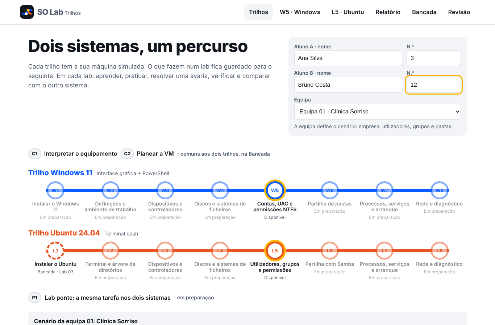
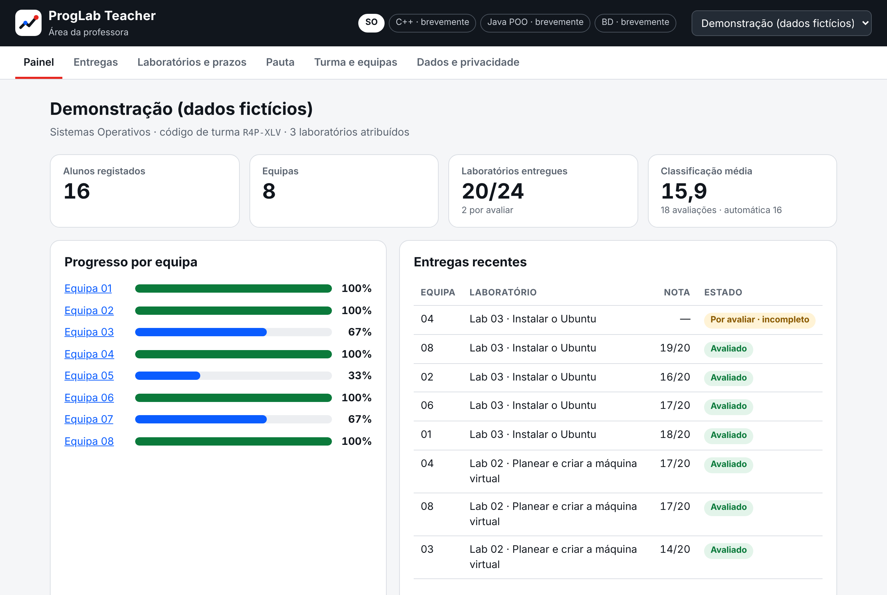

# SO Lab · Laboratórios de Sistemas Operativos

Laboratórios práticos de **Sistemas Operativos** que correm no navegador, sem máquinas virtuais. São para trabalho **a pares (2 alunos)** e seguem a UC02829 (*Instalar, configurar e parametrizar sistemas operativos*) e a UC01990 (*Instalar, configurar e atualizar software complementar aos sistemas operativos*).



## As três partes

| Página | Endereço | O que é |
| --- | --- | --- |
| **Trilhos** | `/` | Produto principal. Dois trilhos, **Windows 11** e **Ubuntu 24.04**, cada um com a sua máquina simulada. Cada lab tem cinco fases: Aprender, Praticar, Avaria, Verificar e Comparar. Já disponíveis: **W5** (contas, UAC e permissões NTFS) e **L5** (utilizadores, grupos e permissões). |
| **Bancada** | `/bancada/` | Labs comuns e de instalação: **Lab 01** (interpretar o equipamento, com firmware UEFI simulado), **Lab 02** (planear e criar a VM, com hipervisor simulado) e **Lab 03** (instalar o Ubuntu, com instalador simulado). Tem cenários para as 8 equipas. |
| **Revisão** | `/revisao/` | 16 labs curtos de revisão de conceitos, com consola de comandos reais, perguntas baralhadas e resposta escrita verificada. |
| **Área da professora** | `/professora/` | **ProgLab Teacher**: turmas, alunos e equipas, laboratórios com prazos, importação das entregas, correção automática, avaliação com feedback, pauta e exportação para Excel. |

Todas as páginas pedem os nomes e números do **Aluno A** e do **Aluno B** e geram um **ficheiro de entrega** para a professora importar na área da professora.

## Endereços

Endereço previsto do site no GitHub Pages: **https://profalexandrapsilva-proglab.github.io/LAB_SO/**

Endereços diretos, úteis para o Classroom ou o Moodle:

- Trilhos: [W5 · Windows](https://profalexandrapsilva-proglab.github.io/LAB_SO/#w5) · [L5 · Ubuntu](https://profalexandrapsilva-proglab.github.io/LAB_SO/#l5) · [Relatório](https://profalexandrapsilva-proglab.github.io/LAB_SO/#relatorio)
- Bancada: [Lab 01](https://profalexandrapsilva-proglab.github.io/LAB_SO/bancada/index.html#lab01) · [Lab 02](https://profalexandrapsilva-proglab.github.io/LAB_SO/bancada/index.html#lab02) · [Lab 03](https://profalexandrapsilva-proglab.github.io/LAB_SO/bancada/index.html#lab03)
- Revisão: [16 labs de conceitos](https://profalexandrapsilva-proglab.github.io/LAB_SO/revisao/index.html)
- Área da professora: [ProgLab Teacher](https://profalexandrapsilva-proglab.github.io/LAB_SO/professora/index.html)

Para atualizar o site, basta substituir os ficheiros no repositório (**Add file → Upload files**). Confirme a publicação em Actions e Settings → Pages; não publique esta versão antes de concluir o teste no navegador.

Para a pré-visualização do repositório nas redes sociais, use `docs/img/capa.png` em **Settings → General → Social preview**.

## Como os alunos trabalham

1. Abrem a página, escrevem os nomes e números dos dois alunos e escolhem a equipa (01 a 08). A equipa define o cenário: empresa, utilizadores, grupos e pastas.
2. Fazem o lab. As missões são verificadas automaticamente pelo **estado** da máquina simulada, por isso qualquer caminho correto conta.
3. No **Relatório**, escrevem o **código de turma** (ou abrem a ligação da professora, que já o traz), carregam em **Descarregar ficheiro de entrega** e enviam o ficheiro `.json` pelo canal combinado (Classroom, Teams ou pen).

> O progresso fica no navegador do PC onde a equipa trabalha (`localStorage`). Se a equipa mudar de PC ou limpar o navegador, recomeça. Nenhum dado é enviado para servidores.

## Área da professora (ProgLab Teacher)



1. Em `/professora/`, criem primeiro o cofre com uma palavra-passe forte (12 ou mais caracteres) e depois criem a turma. A área gera um **código de turma** (por exemplo `K7Q-3MX`).
2. Registem os alunos (número, nome e equipa). Podem colar a lista do Excel.
3. Em **Laboratórios e prazos**, escolham os labs e os prazos e partilhem a ligação com os alunos.
4. Importem os ficheiros de entrega (podem arrastar vários de uma vez). Em cada entrega veem as missões, as perguntas e os erros, as respostas escritas, os comandos executados e uma nota automática sugerida.
5. Atribuam a nota e o feedback e exportem a **pauta** para Excel.

**Sem servidor:** os dados da área ficam cifrados (AES-GCM 256 bits, chave derivada com PBKDF2-SHA-256) em IndexedDB. O cofre pede uma palavra-passe e não é uma conta online. Façam cópias de segurança cifradas em **Dados e privacidade**; guardem a palavra-passe separadamente. Os ficheiros Excel e os JSON dos alunos não são cifrados. Usem um computador e perfil exclusivos e HTTPS. A publicação do código é pública; a cifra protege os dados locais em repouso, não uma sessão aberta. A área está preparada para outras disciplinas (C++, Java POO, Bases de Dados): os ficheiros de entrega usam um formato comum, `proglab-entrega`.

## Estrutura

```
index.html              Trilhos (página principal)
bancada/index.html      Bancada: Labs 01, 02 e 03 e terminais de prática
revisao/index.html      Revisão: 16 labs de conceitos
professora/index.html   Área da professora (ProgLab Teacher)
fichas/                 Fichas imprimíveis dos Labs 01 a 03
docs/roteiro.md         Plano de todos os labs dos trilhos e estado de cada um
docs/programa.md        Alinhamento com a UC02829 e a UC01990
docs/img/               Capturas e imagem de capa
```

## Avisos

- **Soluções:** o guia do professor, com respostas e grelhas, fica fora deste repositório público.
- **Simulação:** os comandos e as janelas são reais, mas as saídas são simuladas. Cada página diz isso aos alunos.
- **Requisitos oficiais:** a correção do Lab 01 segue as páginas da [Microsoft](https://learn.microsoft.com/windows/whats-new/windows-11-requirements) e do [Ubuntu](https://help.ubuntu.com/community/Installation/SystemRequirements). Reveja-as no início de cada ano letivo.
- **Licença:** [CC BY-SA 4.0](https://creativecommons.org/licenses/by-sa/4.0/deed.pt). Podem usar, adaptar e partilhar estes materiais, desde que indiquem a autoria e partilhem as adaptações com a mesma licença. Ver o ficheiro `LICENSE`.

Autoria: Alexandra Silva @ 2026

## ProgLab Teacher — revisão de segurança (candidato v1.1)

- Registe os dois alunos por equipa (01 a 08) e atribua os laboratórios antes de receber entregas. A importação recusa formatos inválidos, equipas/alunos incorretos, selos incoerentes, laboratórios inexistentes e versões duplicadas; laboratórios conhecidos mas não atribuídos são ignorados com aviso.
- O selo é um mecanismo de coerência, não uma assinatura digital. Qualquer aluno pode alterar dados e recalcular o selo. A pontuação automática é apenas indicativa; inconsistências detetadas bloqueiam a sugestão. A nota final exige revisão humana.
- A data de geração vem do equipamento do aluno e não é uma prova de cumprimento de prazo. Confirme os prazos no Teams.
- Após receber entregas, a composição da turma fica bloqueada para proteger a associação das notas. Crie uma nova turma para uma nova composição.
- A primeira abertura tenta migrar dados antigos válidos; faça previamente uma cópia. Cópias antigas JSON podem ser restauradas se passarem a validação; dados incompatíveis são recusados sem substituir os atuais.
- Mantenha o guia privado `docs/professor.md` fora do GitHub. Não publique cópias de segurança, pautas, dados de alunos nem ficheiros de entrega.
- Licença: mantém-se a CC BY-SA 4.0 original. Não foi efetuada qualquer alteração dos direitos de utilização. Se pretender um modelo comercial com restrições adicionais, deve decidir expressamente a licença futura; os direitos já concedidos não são revogados por alterar este ficheiro.
